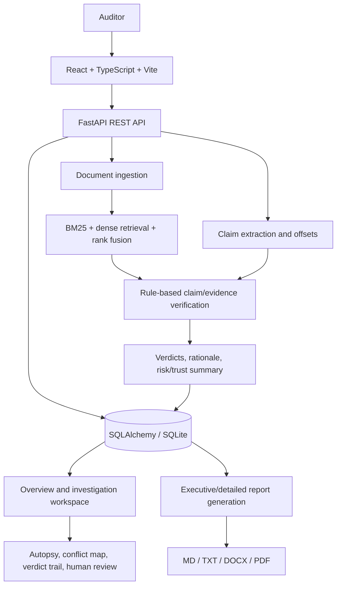

# Second Opinion — Evidence Auditor for AI-Generated Answers

Second Opinion is a local-first auditing platform that checks AI-generated answers against reference material. It breaks an answer into claims, retrieves relevant passages from the supplied documents, compares each claim with the available evidence, and presents the findings in an interactive investigation workspace.

> **Core principle:** a confident-sounding answer is not evidence. Second Opinion is designed to show what a source supports, what it contradicts, and what cannot be established from the provided material.

## Contents

- [Why Second Opinion?](#why-second-opinion)
- [Core workflow](#core-workflow)
- [Features](#features)
- [Verification outcomes](#verification-outcomes)
- [Technology stack](#technology-stack)
- [Architecture](#architecture)
- [Repository layout](#repository-layout)
- [Run locally](#run-locally)
- [Configuration and persistence](#configuration-and-persistence)
- [Reports and exports](#reports-and-exports)
- [Testing](#testing)
- [Current limitations and responsible use](#current-limitations-and-responsible-use)
- [Project-statement alignment](#project-statement-alignment)

## Why Second Opinion?

AI answers can combine correct facts with fabricated details, unsupported claims, incorrect numerical values, or conclusions that do not follow from their cited material. Asking another generative model to check the answer can repeat the same weakness, while manually checking every sentence is slow.

Second Opinion helps an auditor inspect an answer claim by claim and trace findings to reference passages. It is intended to assist verification, not replace a qualified professional or make high-stakes decisions on its own.

## Core workflow

1. **Create an audit:** provide a title and investigation objective.
2. **Add reference material:** upload source files or paste authoritative reference text.
3. **Submit the answer:** paste the AI-generated response being checked.
4. **Review and run:** confirm the inputs and start the audit.
5. **Inspect results:** review the overall summary and the claim register.
6. **Investigate a claim:** inspect evidence excerpts, the claim's explanation, and its place in the original answer.
7. **Use forensic tools:** inspect Claim Autopsy, Verdict Trail, Evidence Conflict Map, and Human Review where available.
8. **Run adversarial checks:** test the verifier against known difficult cases.
9. **Export a report:** choose an executive summary or detailed forensic report and select a supported format.

## Features

### 1. Claim-level verification

- Decomposes an answer into individual assertions so a long response can be inspected piece by piece.
- Maintains start/end offsets into the submitted answer for precise in-context highlighting, including Unicode-aware offsets.
- Presents the verdict and rationale for each extracted claim.
- Provides navigation between claims and an overview/claim-register view.

### 2. Evidence-grounded auditing

- Ingests source documents and associates retrieved passages with claims.
- Uses lexical retrieval (BM25) and dense semantic retrieval, with rank fusion, to help find relevant evidence.
- Shows the source name, relevant excerpt, and available page/section metadata and relevance information.
- Distinguishes evidence that supports a claim, conflicts with it, or lacks sufficient context.
- Lets users move between a claim and its evidence rather than relying only on a top-level score.

### 3. Deterministic verification and consistency checks

- Applies rule-based comparisons to claim/evidence pairs.
- Checks numerical quantities and frequencies when units and attributes are compatible.
- Prevents unrelated attributes—such as annual leave and sick leave—from being treated as interchangeable quantities.
- Gives matching evidence priority before declaring a numerical contradiction when the evidence contains multiple facts.
- Includes regression cases for genuine numerical conflicts and missing evidence.

These checks improve consistency but do not guarantee that every claim is correctly interpreted. Always inspect evidence for consequential decisions.

### 4. Interactive investigation workspace

The workspace keeps the submitted answer visible alongside the selected claim and its evidence. Verdict styling helps users identify claims that are supported, contradicted, unclear, or require further review.

Investigation tools include:

- **Evidence:** retrieved passages and source references.
- **Claim Autopsy:** a deeper view of why a claim received its result, subject to the data exposed by the verifier.
- **Verdict Trail:** the recorded verification/review trail available for that claim.
- **Evidence Conflict Map:** a side-by-side view of evidence passages that appear to disagree.
- **Human Review:** a review/override path that should keep the original machine result distinguishable from a human decision.

### 5. Audit overview and risk summary

- Shows totals for extracted claims and verdict categories.
- Provides a claim register with per-claim status and links to investigation.
- Displays a trust/risk summary intended to help prioritize review.
- Exposes the trust-score calculation and its weighting through an explanatory tooltip.

The trust score is a heuristic summary of the audit's verdict distribution, not a calibrated probability that the whole answer is true. Review the individual claims and evidence rather than relying on the score alone.

### 6. Adversarial Lab

- Runs a built-in set of verifier benchmark cases.
- Compares the actual result against each case's expected verdict.
- Includes tests designed to catch cross-attribute numerical confusion and cases where missing evidence should not be treated as proven contradiction.
- Reports pass/fail outcomes for the test cases executed locally.

The included cases are a regression suite, not proof of general accuracy across all topics or documents.

### 7. Sources and audit management

- Supports a source list attached to an audit and an All Audits view for local sessions.
- Provides a Sources Library view for finding/managing available source material where supported by the current backend.
- Shows audit status, claim/source counts, and access to an existing audit's overview and workspace.
- Offers a one-click sample/demo input in the new-audit flow where available.

### 8. Reports and export formats

Two report levels are available:

- **Executive report:** concise summary, verdict totals, overall assessment, and priority findings.
- **Detailed report:** expanded claim-by-claim findings and evidence details.

Supported export formats:

- Markdown (`.md`)
- Plain text (`.txt`)
- Microsoft Word (`.docx`)
- PDF (`.pdf`)

The report API accepts the audit ID plus a report format and report type. From the backend, the route is `GET /api/audits/{audit_id}/report?format={markdown|txt|docx|pdf}&type={executive|detailed}`. Use the app's download controls for normal operation.

### 9. UI and usability

- Dedicated pages for Dashboard, All Audits, Sources Library, Audit Reports, Adversarial Lab, and Diagnostics & Engine.
- Four-step new-audit wizard: details, reference material, submitted answer, and review/run.
- Light, dark, and system theme options.
- Shared verdict colours and evidence classifications to make review easier.
- Local-first experience designed for an auditor inspecting documents and claims rather than a generic analytics dashboard.

## Verification outcomes

The UI distinguishes the following outcomes. Interpret them using the evidence shown for each claim:

| Outcome          | Meaning                                                                                                                |
| ---------------- | ---------------------------------------------------------------------------------------------------------------------- |
| **Supported**    | Available evidence directly corroborates the claim.                                                                    |
| **Contradicted** | Relevant evidence directly conflicts with the claim.                                                                   |
| **Unsupported**  | The provided evidence does not establish the claim. Absence of evidence is not automatically proof the claim is false. |
| **Ambiguous**    | The claim or the available evidence permits materially different interpretations or contains a conflict.               |
| **Inconclusive** | Retrieved material is insufficient or not directly applicable to determine a stronger verdict.                         |

Exact verdict aggregation and explanations depend on the verification rules and the evidence retrieved. Inspect a claim-level evidence view before drawing conclusions.

## Technology stack

| Layer                  | Technology                                                             | Role                                                                     |
| ---------------------- | ---------------------------------------------------------------------- | ------------------------------------------------------------------------ |
| Web frontend           | React 18, TypeScript, Vite                                             | Interactive single-page application and build tooling.                   |
| Styling and components | Tailwind CSS, shared CSS theme tokens, Lucide React                    | Layout, semantic design tokens, icons, and light/dark/system appearance. |
| Backend API            | Python 3.11+, FastAPI                                                  | REST endpoints for audits, sources, analysis, and report downloads.      |
| Validation and schemas | Pydantic v2                                                            | Request/response schemas and data validation.                            |
| Persistence            | SQLAlchemy 2.x with SQLite by default                                  | Local storage for audit sessions and related records.                    |
| Document extraction    | PyMuPDF (`pymupdf`/`fitz`), `python-docx`, text/Markdown parsers       | Extracts readable content from supported source files.                   |
| Evidence retrieval     | BM25 lexical retrieval, dense semantic retrieval, rank fusion          | Finds candidate passages relevant to each claim.                         |
| Verification           | Python deterministic/rule-based verifier and quantity/attribute checks | Compares claims against evidence and performs consistency checks.        |
| Report generation      | Markdown/text generation, `python-docx`, PyMuPDF                       | Builds executive and detailed reports in four formats.                   |
| Tests                  | Pytest, frontend test runner, TypeScript/Vite production build         | Backend regression/integration checks and frontend/build validation.     |

The current user experience is local-first and shows a local SQLite session. Do not assume cloud deployment, multi-user tenancy, or authentication unless those are explicitly implemented and configured in the current branch.

## Architecture



### Main repository areas

```text
.
├── apps/
│   └── web/                  # React frontend
│       └── src/
│           ├── components/   # App shell, shared UI, verdict badge
│           ├── features/     # Audit, claims, evidence, reports, sources
│           ├── pages/        # Dashboard, wizard, audit and utility pages
│           └── theme/        # Light/dark/system theme context
├── services/
│   └── api/
│       ├── app/
│       │   ├── api/          # FastAPI routes
│       │   ├── database/     # SQLAlchemy setup
│       │   ├── ingestion/    # Source parsing and chunking
│       │   ├── retrieval/    # Evidence search
│       │   ├── verification/ # Verdict and numerical rules, adversarial suite
│       │   └── reporting/    # Executive and detailed exports
│       └── tests/            # Backend tests
├── docs/                     # Architecture, contracts and project docs
├── docker-compose.yml        # Optional container setup, if configured
└── README.md
```

Folder names may evolve as the project changes; inspect the current tree before relying on this outline for exact file paths.

## Run locally

### Prerequisites

- Python 3.11 or newer
- Node.js 20 or newer (Node 18+ may work depending on lockfile/package requirements)
- npm

### 1. Start the backend

From the repository root:

```bash
cd services/api
python3 -m venv .venv
source .venv/bin/activate          # Windows: .venv\Scripts\activate
pip install -r requirements.txt
uvicorn app.main:app --reload --host 127.0.0.1 --port 8000
```

Backend endpoints:

- API base: `http://127.0.0.1:8000`
- Interactive API docs: `http://127.0.0.1:8000/docs`
- Health check, if enabled: `http://127.0.0.1:8000/api/health`

### 2. Start the frontend

Open a second terminal from the repository root:

```bash
cd apps/web
npm install
npm run dev
```

Open the local URL printed by Vite (commonly `http://127.0.0.1:5173`). Keep both processes running while using the application.

### 3. Run tests and build

Backend, from the repository root after creating `services/api/.venv`:

```bash
services/api/.venv/bin/pytest services/api/tests
```

Alternatively, from `services/api` with the virtual environment activated:

```bash
pytest tests
```

Frontend, from `apps/web`:

```bash
npm test
npm run build
```

If any command differs from the current package scripts or environment, use the scripts and dependency lockfiles present in your checked-out branch.

## Configuration and persistence

- The default local setup uses SQLite via SQLAlchemy. The UI identifies the session as local.
- The API server is usually on port `8000`; Vite commonly uses port `5173`.
- If the frontend cannot reach the backend, check the environment variable used by the frontend API client (commonly `VITE_API_URL`) and ensure it points at the running backend base URL with the expected `/api` prefix.
- Do not commit API keys, database files, uploaded private documents, or other secrets. Use a local `.env` and the repository's `.gitignore` where applicable.

## Project-statement alignment

| Expected feature                   | How Second Opinion addresses it                                                                                                  |
| ---------------------------------- | -------------------------------------------------------------------------------------------------------------------------------- |
| Claim-level verification           | Extracts assertions and assigns a verdict per claim.                                                                             |
| Evidence-grounded auditing         | Shows source excerpts and claim-linked evidence.                                                                                 |
| Precise error localization         | Highlights the claim span in the submitted answer using offsets.                                                                 |
| Reasoning consistency checks       | Applies deterministic numerical and attribute-compatibility rules.                                                               |
| Uncertainty and ambiguity handling | Distinguishes contradicted claims from unsupported, ambiguous, and inconclusive findings.                                        |
| Confidence-calibrated reporting    | Displays claim confidence and an explanatory trust-score formula; these must be interpreted as system estimates, not guarantees. |
| Interactive audit dashboard        | Offers overview metrics, a claim register, and drill-down into an investigation workspace.                                       |

## Current limitations and responsible use

- Results depend on the quality and coverage of user-provided references, extraction quality, retrieval, claim decomposition, and verification rules.
- Complex scanned PDFs, nested tables, and poorly structured documents can extract imperfectly; inspect source excerpts before trusting a verdict.
- Rule-based numerical comparisons are deliberately cautious but cannot understand every domain-specific relationship or implication.
- A passing adversarial suite is evidence that the included cases pass—not proof of universal accuracy.
- Trust score and confidence are not independent guarantees of truth and should not replace evidence inspection.
- Human review is provided as a workflow aid; the human decision should remain distinguishable from the original system verdict.
- This is an auditing aid, not a substitute for clinical, legal, financial, regulatory, or engineering expertise. Do not use it as the sole basis for high-impact decisions.
- The current setup is local-first; do not treat it as a production-hardened, multi-user service without further security, privacy, deployment, and authentication work.

## Development notes

When changing the verification logic, add regression tests for both the failing case and nearby correct cases. For example, a claim of 12 days of sick leave must not be contradicted by a reference to 18 days of annual leave, while a genuine disagreement about sick-leave entitlement should still be detected.

Before sharing a build, run backend tests, frontend tests, the production build, and a complete sample workflow from creating an audit through report export.
